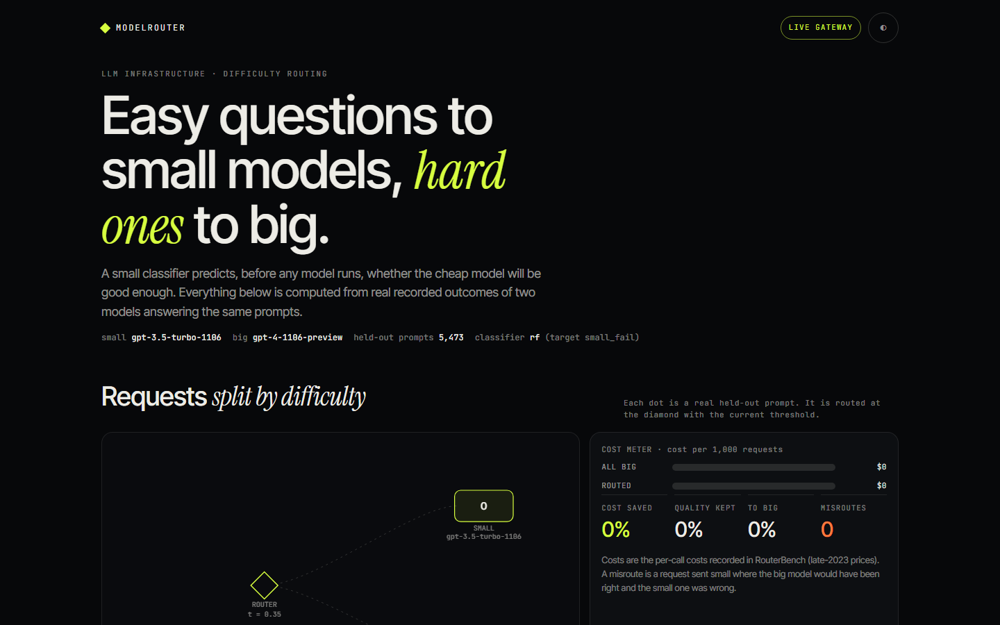
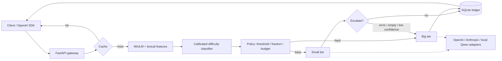
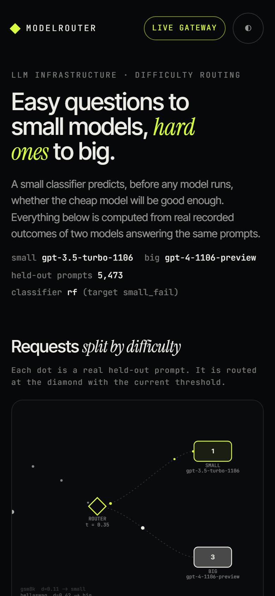

# ModelRouter

Easy questions go to a small model, hard ones to a big model. A small scikit-learn classifier predicts, before any LLM runs, whether the cheap model will be good enough; an OpenAI-compatible gateway uses that score to route each request and keeps a ledger of what it saved.



Live demo (recorded run, no backend): the `docs/` folder is a static site; see [Static demo](#static-demo).

## What is in here

- **Offline lab.** A difficulty classifier trained on [RouterBench](https://github.com/withmartian/routerbench)'s recorded outcomes of 11 LLMs on 36,481 prompts. Because every model's answer is already recorded, a router can be scored with no API calls: for any threshold, quality and cost are read off the recorded outcomes of whichever model the router picked.
- **Gateway.** FastAPI, `POST /v1/chat/completions` (OpenAI schema, `model: "auto"`), threshold / target-fraction / budget policies, escalation from small to big on error, empty output or low confidence, an LRU cache, and a SQLite cost ledger that books routed cost against the send-everything-to-big counterfactual.
- **Providers.** OpenAI and Anthropic adapters (httpx, retries, usage parsing), plus a local transformers backend. Prices come from an editable `config/pricing.yaml` with a lookup date.
- **UI.** Real held-out prompts stream into a small lane and a big lane, a cost meter compares routed cost with all-big, and a threshold slider re-routes the whole evaluation set in the browser along the true cost-quality curve.



## Results

All numbers below are in `results/*.json` and are produced by the commands in [Reproduce](#reproduce). Design notes and the research behind the choices are in [`docs/notes/`](docs/notes).

### Offline: RouterBench recorded outcomes (the main evidence)

Headline pair: `gpt-3.5-turbo-1106` (small) vs `gpt-4-1106-preview` (big). Costs are RouterBench's recorded per-call costs at **November 2023** prices, kept separate from the current prices in `config/pricing.yaml`. Split: 85% development / 15% held-out test (5,473 prompts), by prompt, stratified by sub-benchmark; the test set was scored once. Classifier chosen by out-of-fold APGR on the development data: a calibrated random forest predicting "the small model gets it wrong".

| Held-out test, pair A | value |
|---|---|
| always-small quality / always-big quality | 0.630 / 0.782 |
| AUC of the classifier | 0.720 |
| APGR (random routing = 0.5) | 0.693 |
| AIQ (random routing: 0.706) | 0.746 |
| CPT 90% / 95% / 99% (share of calls to big needed to keep that fraction of big's quality) | 24% / 42% / 76% |
| at the 95% operating point | 42% of calls to big, 37% of the all-big cost (about 63% cheaper) |
| advantage over random routing at 30% to big | +0.043 quality, 95% bootstrap interval [+0.036, +0.048] |
| oracle CPT 95% (upper bound) | 11% |

Second pair, `mixtral-8x7b-chat` vs `gpt-4-1106-preview`: AUC 0.730, APGR 0.681, CPT 95% = 60% of calls to big (at that point about 66% of the all-big cost at 0.951 of big's quality); advantage over random at 30% +0.066 [+0.060, +0.072]. The quality gap is larger here, so there is more to lose by routing badly.

Model comparison (4-fold CV on development data, target "small model fails", pair A; calibration happens inside each fold):

| model | AUC | Brier | ECE | APGR | CPT 95% |
|---|---|---|---|---|---|
| logistic regression, lexical features only | 0.662 | 0.207 | 0.022 | 0.633 | 56% |
| logistic regression, embeddings + lexical | 0.695 | 0.200 | 0.012 | 0.638 | 55% |
| HistGradientBoosting | 0.705 | 0.197 | 0.008 | 0.650 | 53% |
| random forest (selected) | 0.702 | 0.198 | 0.008 | 0.652 | 53% |
| MLP | 0.689 | 0.202 | 0.021 | 0.631 | 56% |
| baseline: sub-benchmark identity only | 0.690 | 0.199 | 0.003 | 0.615 | 54% |
| baseline: benchmark family only | 0.606 | 0.214 | 0.001 | 0.583 | 63% |

### What the router actually learns (read this before trusting the headline)

The sub-benchmark identity alone gets APGR 0.615 against 0.652 for the best model, so **most of the in-distribution skill is recognising which kind of task a prompt belongs to**, not judging how hard an individual item is. The leave-one-benchmark-family-out test makes that concrete: train on the other families, test on the held-out one.

| held-out family | n | AUC | APGR | advantage vs random at 30% [95% CI] |
|---|---|---|---|---|
| arc-challenge | 1,470 | 0.576 | 0.584 | +0.013 [+0.004, +0.020] |
| gsm8k | 7,450 | 0.491 | 0.473 | -0.001 [-0.003, +0.001] |
| hellaswag | 10,042 | 0.505 | 0.519 | +0.007 [+0.001, +0.012] |
| mbpp | 425 | 0.504 | 0.458 | -0.002 [-0.018, +0.015] |
| mmlu | 14,037 | 0.594 | 0.542 | +0.007 [+0.004, +0.009] |
| mt-bench | 80 | 0.649 | 0.465 | -0.012 [-0.057, +0.027] |
| other | 1,710 | 0.457 | 0.571 | +0.006 [-0.001, +0.012] |
| winogrande | 1,267 | 0.496 | 0.496 | -0.001 [-0.015, +0.011] |

On an unseen benchmark family the router is close to random: AUC near 0.5 for most families and advantages over random routing of about a percentage point or less. The in-distribution gain is real on this benchmark mix, but it would not be safe to assume it transfers to a different traffic mix without retraining on that traffic. The same table for the Mixtral pair is in `results/offline_mixtral_vs_gpt4.json`.

### Live: a small local pair on this machine (a demonstration, not evidence)

`Qwen2.5-0.5B-Instruct` (small) and `Qwen2.5-1.5B-Instruct` (big) answered 240 multiple-choice questions (60 each from ARC-Easy, ARC-Challenge, CommonsenseQA and MMLU), one model in memory at a time on CPU, through the same provider code the gateway uses. The reply is forced to start with "The correct answer is" so the letter is emitted within four tokens.

| | accuracy |
|---|---|
| small | 56.7% |
| big | 78.3% |
| oracle (best of the two per question) | 81.7% |

Mean latency per question was 1.0 s (small) and 5.3 s (big); these were measured while other jobs shared the CPU, so treat them as indicative. The big model was strictly better on 25% of questions. Cost here is a compute proxy (prompt tokens x parameters), not dollars.

| router for this pair | AUC | APGR | advantage vs random at 30% [95% CI] |
|---|---|---|---|
| trained on the 240 local labels, 5-fold CV | 0.468 | 0.474 | -0.004 [-0.033, +0.024] |
| benchmark identity only | 0.527 | 0.504 | +0.003 [-0.027, +0.032] |
| RouterBench router, transferred | 0.474 | 0.449 | -0.019 [-0.050, +0.008] |

**Negative result.** With 240 labels and four similar benchmarks, no router beats random routing here; every interval includes zero. This experiment shows the mechanism end to end (two real models, real correctness labels, real latencies), not that routing helps for this pair. For that reason the gateway's default router is the one trained on RouterBench, and it is applied to the local pair only as a demonstration of the plumbing.

## What was exercised for real

| path | status |
|---|---|
| RouterBench loading, classifier training, offline evaluation | run end to end here; numbers above |
| Local Qwen pair behind the gateway (playground, ledger, cache) | run end to end here |
| OpenAI and Anthropic adapters | **tested against stubbed HTTP only** (`httpx.MockTransport`); never called against the live APIs, because I had no keys |
| Escalation, cache, policies, ledger | unit tests with stub providers, plus the local pair |

## Quickstart

```bash
git clone https://github.com/Aditya2616/ModelRouter && cd ModelRouter
python -m venv .venv && source .venv/bin/activate      # Windows: .venv\Scripts\activate
pip install -e ".[dev]"
modelrouter data                      # downloads RouterBench 0-shot (~100 MB), checks its SHA-256, writes data/routerbench_slim.parquet
python scripts/embed_routerbench.py   # MiniLM embeddings of 36k prompts (CPU, resumable, ~45 min)
modelrouter train --pair gpt35_vs_gpt4
modelrouter serve                     # http://127.0.0.1:8109
```

`modelrouter route "your prompt"` prints a difficulty score. The first request that runs a local model downloads Qwen2.5-0.5B/1.5B-Instruct (about 4 GB). To use hosted tiers instead, copy `.env.example` to `.env`, set `OPENAI_API_KEY` / `ANTHROPIC_API_KEY`, and change the tiers in `config/gateway.yaml`. Keys are read from the environment and are never logged or stored.

Any OpenAI client works against the gateway:

```python
from openai import OpenAI
client = OpenAI(base_url="http://127.0.0.1:8109/v1", api_key="unused")
r = client.chat.completions.create(model="auto", messages=[{"role": "user", "content": "What is the capital of France?"}])
print(r.choices[0].message.content, r.model_extra["router"])   # difficulty, tier, cost, saving
```

### Reproduce

```bash
python scripts/reproduce_results.py          # data, both pairs, live experiment, web data, docs build (long on CPU)
python scripts/reproduce_results.py --skip-live
```

Run `scripts/embed_routerbench.py` first, otherwise `train` embeds the prompts itself. Training both pairs took about 25 minutes and the live experiment about 25 minutes with 3 CPU threads. Tests and lint: `pytest` (48 fast tests, offline) and `ruff check .`; `pytest -m slow` runs a model test that needs the Qwen download.

### Static demo

`docs/` is the same UI with recorded data, ready for GitHub Pages: `python -m http.server -d docs 8109`. It shows only derived per-item numbers (predicted difficulty, each tier's recorded score and cost, task label). Prompt text is shown for a few dozen items from benchmarks whose own licences permit redistribution (MMLU, GSM8K, HellaSwag: MIT; Winogrande: Apache-2.0), shortened; other items show the task label only. `scripts/screenshot.py` checks the page at 1440x900 and 390x844 (touch).



## Design decisions

- **Predict, then verify.** A pre-call classifier decides the tier; a cheap post-call check (error, empty answer, low mean token logprob locally) escalates to the big tier and books both costs.
- **Random routing is the baseline**, not always-small: mixing two models at random already gives a straight line between them, so a router must beat that line. Intervals come from paired bootstrap.
- **Calibrated probabilities.** Scores are calibrated inside each fold, which lets one threshold mean the same thing across policies; the fraction policy maps a target share to a score quantile.
- **Safe loading.** RouterBench ships as a pickle. `modelrouter data` checks a pinned SHA-256 and unpickles with an allow-list that only permits pandas/numpy reconstruction classes (tested against a crafted malicious pickle), then stores Parquet.
- **Pricing.** `config/pricing.yaml` holds current list prices with a `price_date` and a note that prices change; edit it for your contract.

## Limitations

- RouterBench is benchmark-style (multiple choice, math, code), not open-ended chat traffic, and its models and prices are from late 2023.
- The router does not generalise to unseen benchmark families (table above). Treat the headline savings as in-distribution.
- The live experiment is small (240 items, one run) and shows no routing benefit.
- Hosted adapters are untested against the real APIs. Current prices in `config/pricing.yaml` were copied from the providers' public pricing pages on 2026-11-12 and may have changed.
- Latency numbers come from a shared CPU.

## Data, models and licences

Code: MIT (see `LICENSE`). **RouterBench** (Hu et al., 2024): the dataset card on Hugging Face carries no licence, its code repository is MIT, and the data is not included here; it is downloaded at run time. Its prompts come from public benchmarks with their own licences (credited above for the ones shown). Also used: sentence-transformers `all-MiniLM-L6-v2` (Apache-2.0), Qwen2.5-0.5B/1.5B-Instruct (Apache-2.0), ARC (CC-BY-SA), CommonsenseQA and MMLU (MIT). Ideas and metrics from FrugalGPT, Hybrid LLM, AutoMix and RouteLLM (CPT, APGR); see `docs/notes/research.md`.

---

Built by [Aditya Jain](https://adityajain16.vercel.app) · [github.com/Aditya2616/ModelRouter](https://github.com/Aditya2616/ModelRouter)
