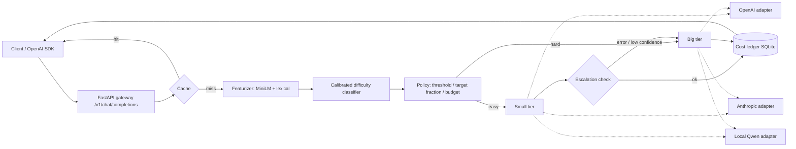

# ModelRouter: design notes

Repo `ModelRouter`, port 8109, MIT, copyright Aditya Jain. Promise from the portfolio: a small classifier predicts how hard each request is; easy ones go to a fast cheap model, hard ones to a larger model, to lower API cost. Stack: Python, OpenAI / Anthropic APIs, scikit-learn.

## As built (differences from the plan below)

These notes were written before building. What changed:

- Commands: `modelrouter data` (not `data fetch`), `train`, `live`, `route`, `serve`; evaluation runs inside `train`, there is no separate `evaluate` command. `scripts/embed_routerbench.py` embeds the prompts in resumable chunks.
- Split: 85% development / 15% held-out test (by prompt, stratified by sub-benchmark) with 4-fold CV on the development part, instead of 70/15/15. Leave-one-benchmark-family-out replaces grouped CV.
- Targets: both "big strictly better" and "small fails" were compared; "small fails" with a random forest was selected on out-of-fold APGR. Outputs are `results/offline_<pair>.json`, `results/test_predictions_<pair>.parquet` and `models/router_<pair>.joblib` (no `metrics.json`).
- Live experiment: 300 multiple-choice questions (75 each from ARC-Easy, ARC-Challenge, CommonsenseQA, MMLU), not GSM8K; both Qwen models in float16 on one GPU, one at a time, with the reply forced to start "The correct answer is". The router trained on those labels is no better than random, so the gateway defaults to the RouterBench router. The end-to-end gateway run was checked by hand through the playground; it is not part of `results/live.json`.
- Interface: the stream, cost meter, slider, curve and playground were built as planned; tapping a particle for a prompt card was replaced by the list of recorded prompts. Prompt text is bundled only for MMLU and GSM8K.
- Numbers in the README are generated by `scripts/check_numbers.py` and checked by a test.

## 1. Architecture



Two independent halves joined by a saved model file: the offline lab (`data`, `features`, `train`, `evaluate`) and the online gateway (`router`, `providers`, `gateway`).

## 2. Module layout

```
ModelRouter/
  pyproject.toml  requirements.txt  .env.example  LICENSE  README.md  docs/notes/{research,design}.md
  config/pricing.yaml          editable USD per 1M tokens, price_date, note that prices change
  config/gateway.yaml          tiers, provider per tier, policy, threshold, escalation, cache
  src/modelrouter/
    data.py          download RouterBench 0-shot, SHA-256 check, safe allow-list unpickle, slim Parquet
    features.py      MiniLM embeddings (batched, cached to .npy) + lexical features
    train.py         model zoo, grouped CV, calibration, saves router.joblib + metrics.json
    evaluate.py      cost-quality curve, CPT, APGR, AIQ, baselines, oracle, random bands
    router.py        DifficultyRouter.score(prompt) -> p_hard ; policies (threshold, fraction, budget)
    pricing.py       load pricing.yaml, cost(model, in_tok, out_tok), token estimate
    providers/       base.py (Provider protocol), openai.py, anthropic.py, local.py, stub.py
    gateway/         app.py (FastAPI), schemas.py, cache.py, ledger.py, escalation.py
    live.py          live experiment runner on local Qwen pair (GSM8K / CommonsenseQA / ARC subsets)
    cli.py           modelrouter data|train|evaluate|serve|live|route "prompt"
  web/               index.html, app.js (ES modules), style.css; served at /
  docs/              static demo: same UI + recorded JSON from real runs; assets/ screenshots
  tests/             pytest (fast, offline); `@pytest.mark.slow` for model downloads
  scripts/           reproduce_results.py, screenshot.py (Playwright), build_docs.py
  .github/workflows/ci.yml     ruff + fast tests
```

## 3. Data flow and key decisions

**Offline.** `data fetch` gets the 0-shot RouterBench file, converts to `data/routerbench.parquet` (prompt, task, group, score and cost for the 11 models; responses dropped). Pair A: gpt-3.5-turbo-1106 (small) vs gpt-4-1106-preview (big). Pair B: mixtral-8x7b vs gpt-4. Label `small_ok = score_small >= 0.5`. Split: 70/15/15 by prompt, stratified by task; plus leave-task-group-out CV for generalisation. Features cached on disk. Models: logistic regression, HistGradientBoosting, random forest, MLP; calibrated (isotonic vs sigmoid chosen by CV Brier). Metrics for choosing: AUC, Brier, ECE, then the routing curve (AIQ, APGR, CPT) on validation; the test set is evaluated once.

**Routing quality is measured on recorded outcomes.** For threshold t: route to big if p_hard >= t; quality = mean of the recorded score of the chosen model per prompt; cost = mean recorded cost of the chosen model. Reported against always-small, always-big, random (mean and 5-95 band over 200 seeds) and oracle. Headline: quality retained vs fraction of traffic to big, and CPT(95%).

**Online.** One `DifficultyRouter` (embedder + calibrated classifier) loaded at startup. Policies: `threshold` (fixed), `fraction` (target share to big, threshold = quantile of a sliding window of recent scores), `budget` (USD per 1k requests, adaptive). Escalation: small error/timeout/empty/low confidence -> run big, ledger books both costs. Local provider returns mean token logprob for the confidence signal; for hosted providers the logprob is used where the API returns it, else a heuristic (empty, truncated, refusal phrase). Cache: normalised (messages, params) exact match, LRU with TTL; cache hits cost zero and are tagged. Ledger (SQLite): timestamp, prompt hash, difficulty, tier, model, tokens, cost, all-big counterfactual cost, escalated, cached, latency.

**API.** `POST /v1/chat/completions` (OpenAI schema; `model: "auto"` default, or pin a tier; `stream` supported by emitting SSE chunks), response adds `router: {difficulty, threshold, tier, model, escalated, cached, cost_usd, big_only_cost_usd, saving_usd}`. `GET /v1/models`, `GET /health`, `POST /v1/route` (score only, no generation; powers the playground), `GET /v1/ledger/summary`, `GET/PUT /v1/policy`, `GET /v1/eval/curve` (real curve, test set), `POST /v1/eval/route?threshold=` (re-routes the evaluation set at a threshold and returns per-prompt routes plus aggregates, cheap numpy).

**Providers.** One `Provider` protocol: `complete(messages, **params) -> Completion(text, usage, logprob, latency)`. OpenAI and Anthropic adapters use httpx directly (injectable transport) so tests use `httpx.MockTransport`; keys from env (`OPENAI_API_KEY`, `ANTHROPIC_API_KEY`); no keys -> adapter refuses with a clear error and the gateway defaults to the local pair. Local: transformers Qwen2.5-0.5B/1.5B-Instruct, CPU, chat template, greedy, `max_new_tokens` capped.

**Pricing.** `config/pricing.yaml` per model: input and output USD per 1M tokens, `price_date`, `source_url`, plus a top-level note that prices change and the file is user-editable. I look the OpenAI and Anthropic prices up at build time and write the date. The local models are priced at 0 in dollars, so the live experiment also reports a compute-cost proxy (measured seconds and parameter-count-weighted FLOPs per request), clearly labelled as a proxy and not dollars.

## 4. Real results the project will produce

1. `results/offline.json`: model comparison table (AUC, Brier, ECE, AIQ, APGR, CPT) with CV, leave-task-out results, final test metrics; cost-quality curves for Pair A and B with baselines and random band; per-task breakdown.
2. `results/live.json`: live experiment on this machine: 240 items (60 each from ARC-Easy, ARC-Challenge, CommonsenseQA, MMLU) with known answers, both Qwen models run on all of them (so labels and recorded latency are real), router trained on local labels with CV, then the routed-mix curve plus a real end-to-end gateway run of routed requests with measured latency; also the transfer of the RouterBench router. Reported with confidence intervals (bootstrap).
3. Honest framing: offline results = recorded outcomes of hosted models, priced at Nov 2023 rates; live results = small local pair, benchmark-style prompts; neither is a claim about production traffic.

## 5. UI concept (the full-size version of the site's `router` scene)

Dark void page, lime accent for the small/cheap tier and routing flow, orange only for escalations and failures. Inter Tight / Instrument Serif italic / JetBrains Mono. One page, four zones, phone-first single column that becomes a two-column grid on desktop:

1. **Stream (canvas, hero).** Real evaluation prompts stream in from the left as particles carrying their predicted difficulty (position/colour intensity); a threshold line splits them into two lanes: small tier (cheap, lime) and big tier. Each particle is a real test-set prompt with its true outcome revealed on arrival (small was right/wrong), so misroutes are visible, not hidden. Tapping a particle opens a card with the prompt text, score, route, true outcome. Rates controlled by a speed toggle; paused off screen; DPR capped; reduced-motion shows static counts.
2. **Cost meter.** Two bars: routed cost vs send-everything-to-big, with running totals, % saved and quality retained, all computed from the same stream of real records and updated as particles land.
3. **Threshold slider** (large touch target) re-routes the whole evaluation set live via the in-browser data (the docs build ships per-prompt scores and outcomes as compact JSON, so no backend is needed) and moves a marker along the true cost-quality curve, which is plotted with always-small, always-big, random band and oracle. CPT/APGR shown as labelled readouts. Presets: "match big 95%", "50% budget".
4. **Playground.** Textarea plus examples; shows difficulty gauge, chosen tier, estimated cost with each price config, and in local mode the actual answer with routing metadata, escalation and cache flags. Static demo mode: the playground is disabled for free text (no model in the browser) and instead offers recorded prompts with their stored real scores, clearly labelled "recorded run".

Extras: ledger table (recent requests, saved USD), policy switch (threshold/fraction/budget), theme toggle if cheap. Footer: "Built by Aditya Jain" -> https://adityajain16.vercel.app and the GitHub repo. All numbers on the page come from `results/*.json` or live API calls.

## 6. Test plan

Fast offline (default): feature extraction determinism and shapes; safe unpickler rejects a malicious pickle (test with a crafted `os.system` payload that must be blocked); data conversion on a synthetic mini-DataFrame; metrics (CPT, APGR, AIQ) against hand-computed toy cases, random baseline lies on the straight line in expectation, oracle dominates; threshold monotonicity (higher threshold sends fewer to big); quantile policy hits its target fraction on a synthetic stream within tolerance; budget policy keeps spend under budget on a synthetic stream; pricing arithmetic and config validation; OpenAI and Anthropic adapters against `httpx.MockTransport` (request shape, headers, errors, usage parsing, retries/timeouts); escalation on error, empty output, low logprob, and that both costs are booked; cache hit/miss and TTL; ledger totals and counterfactual saving; gateway via `TestClient` with stub providers and a stub router (response schema, `router` metadata, streaming, `/health`, auth-less local mode, bad input 422). Slow, marked `slow`: train a tiny router on a real 2k-row slice and check AUC > 0.5; Qwen 0.5B generates a token.

## 7. Definition of done

- Fresh clone, new venv, README quickstart works: `modelrouter data fetch`, `train`, `evaluate`, `serve`, UI loads at http://127.0.0.1:8109.
- `pytest` (fast) and `ruff check` pass; CI workflow present.
- `results/offline.json` and `results/live.json` produced by `scripts/reproduce_results.py`; README tables copied from them.
- UI verified by Playwright screenshots at 1440x900 and 390x844 touch, no console errors, no horizontal scroll, 60 fps stream; `docs/` demo works from a plain static server.
- README: first person, Mermaid diagram, honest limitations, what was exercised for real (local pair, offline RouterBench) vs stub-tested (OpenAI, Anthropic adapters), credits and licences (RouterBench, RouteLLM and Hybrid LLM papers, Qwen, MiniLM).
- Clean git history on `main`, Aditya's identity, no AI mentions, no weights or datasets committed, nothing pushed.

## 8. Build order

1) scaffold, data fetch + safe loader + tests; 2) features, training, evaluation, results; 3) pricing, providers + stubbed tests; 4) router policies, cache, ledger, escalation, gateway + tests; 5) local pair live experiment; 6) UI (web + docs static build); 7) screenshots, README, clean-clone check.
